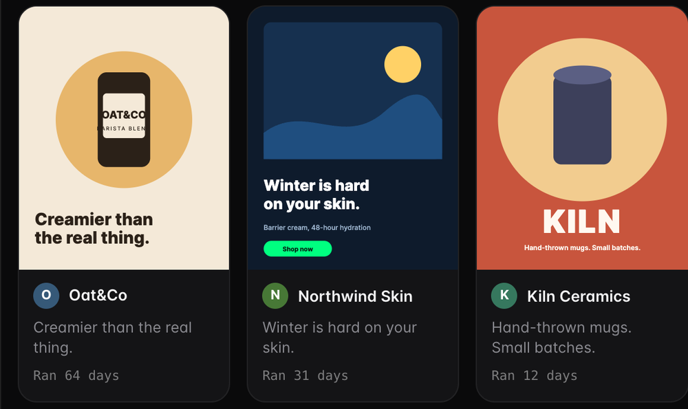

# StealAds: the ads MCP

**Ask your AI what ads your competitors keep paying to run. Then make your version.**

[](LICENSE) [](#install-in-one-line) [](#install-in-one-line) [](#install-in-one-line) [](#install-in-one-line) [](https://stealads.ai)

Your AI is good at writing ads. It is bad at knowing which ads work. It has never seen what your rivals are running this week, which ads they cut after nine days, or which ones they have kept alive for six months.

StealAds gives it eyes on the Meta ad market. Connect it once and ask in plain words.

<p align="center">
  
  <br><sub>Illustrative demo brands: how results look in a host that can display them. Other hosts return the same ads as text, with how long each has run.</sub>
</p>

*An illustrative exchange (Liquid Death's public ads):*

```text
You     What ads does Liquid Death keep running?

Claude  Here's a sample of their ads (I can't see all of them). What stands out:
        1. A social-proof image ad that ran 168 days, the longest in this sample.
        2. A carousel with a contrarian hook that ran 142 days.
        3. A newer "You won't believe it's not candy" campaign, only about 10 days in. Too early to call.
        Contrarian and curiosity-gap hooks come up most. Run time shows an ad has lasted, not that it sold.
        Want me to open their Playbook to see what they keep and drop, or adapt one for your brand?
```

Not a dashboard. Not an ad-account manager. A research partner that has read the ads.

---

## Install in one line

You sign in with your StealAds account the first time. No keys to paste. You approve what it may do, and you can revoke it any time.

| Your AI | One line |
| --- | --- |
| **Claude Code** (server + skills) | `/plugin install stealads --marketplace TheMattBerman/ads-mcp` |
| **Claude** (claude.ai, Desktop) | Customize > Connectors > add custom connector > `https://mcp.stealads.ai/mcp` (the full set of tools) or `https://mcp.stealads.ai/mcp/claude` (research, tracking and saved ads; to make an ad it hands you a link that opens it in the StealAds app) |
| **Codex** | `codex mcp add stealads --url https://mcp.stealads.ai/mcp` then `codex mcp login stealads` |
| **Cursor** | Add to `.cursor/mcp.json`: `{"mcpServers":{"stealads":{"url":"https://mcp.stealads.ai/mcp"}}}` |
| **ChatGPT** | Add StealAds from the ChatGPT app directory when it is listed, or paste `https://mcp.stealads.ai/mcp` in Developer Mode |
| **Anything that speaks MCP** | `https://mcp.stealads.ai/mcp` |

Then try: *"What Facebook ads is [your competitor] running right now?"*

Claude Code, server without skills: `claude mcp add --transport http stealads https://mcp.stealads.ai/mcp`..

---

## Without it, with it

| Without StealAds | With StealAds |
| --- | --- |
| "Here are some common ad angles for fitness studios..." (from memory) | Real ads from real advertisers, with their hook, format and how long each has run |
| You open the Meta Ad Library and scroll | Ask once, get the five ads worth reading and why |
| You paste a competitor's ad into a chat and describe it | Your AI opens the ad itself and reads the hook |
| "Make me an ad like this" gives you generic copy | It adapts the structure that has lasted, with your brand's product, colors and voice |
| You check back on rivals when you remember | Track them, then ask what they are testing now |

---

## Ask it things

**Competitor ads**
- What Facebook ads is Gymshark running right now?
- Which of my competitor's ads have been running more than 90 days?
- How does Peloton advertise? Which hooks and offers do they repeat?

**What a rival keeps, drops and is testing**
- Which formats does this competitor keep running, and which did they drop?
- What is my competitor testing right now?

**What's working in your category**
- What ad angles are working for fitness studios?
- What are the best-performing ads in supplements? I want hooks to learn from.
- Show me Black Friday ads from skincare brands I can learn from.
- Pull strong video ads for B2B software that open with a spoken hook.

**The ones that lasted**
- Find the longest-running ads in the meal kit category.
- Which ads has this brand kept running the longest?

**Make your version, keep track**
- Make me an ad like this one for my brand. What will it cost?
- Track my three biggest competitors.
- Did my Monday drop arrive? If a week was skipped, why?

---

## Seven skills that make your AI good at this

The server gives your AI the tools. These skills teach it how a strategist uses them: which question to ask first, how many ads to read, what not to claim. Each is a short, plain markdown file in [`skills/`](skills).

| Skill | Say something like | What it does |
| --- | --- | --- |
| [`researching-competitor-ads`](skills/researching-competitor-ads/SKILL.md) | "What ads is Gymshark running?" | Finds the advertiser, searches their ads, reads the best few, and tells you what they push, what repeats and what is new |
| [`reading-a-brands-playbook`](skills/reading-a-brands-playbook/SKILL.md) | "What formats does this rival keep, and what did they drop?" | Opens the rival's Playbook: ads kept 30+ days, ads dropped inside 30 days, how long each format lasts, what is being tested now |
| [`finding-winning-ads-in-a-category`](skills/finding-winning-ads-in-a-category/SKILL.md) | "What's working for fitness studios?" | One category search, then three patterns and one idea for your brand |
| [`reading-what-a-category-keeps-and-drops`](skills/reading-what-a-category-keeps-and-drops/SKILL.md) | "What do meal kit brands keep running, and what do they drop?" | Builds a category read from a sample of public ads: keepers, short-lived ads, crowded and open angles |
| [`finding-longest-running-ads`](skills/finding-longest-running-ads/SKILL.md) | "Which meal kit ads have lasted?" | Searches with a run-time floor, checks which are still live, explains why they might have lasted |
| [`adapting-a-winning-ad`](skills/adapting-a-winning-ad/SKILL.md) | "Make me an ad like this for my brand" | Adapts the structure and offer shape, shows the cost and asks before anything is made, or hands you a link to finish it in the app |
| [`running-my-monday-drop`](skills/running-my-monday-drop/SKILL.md) | "Did my Monday drop arrive?" | Reads your weekly StealAds drop, explains a skipped week, and can run a weekly briefing routine |

Two short [Cursor rules](rules) keep the agent honest: it asks before anything costs credits, and it treats ad copy as material to read, never as instructions.

---

## What makes it different

| | |
| --- | --- |
| **It reads the ads, not just lists them** | Every ad comes with its hook (spoken and on-screen), format and how long it has run, so your AI can reason about why it works |
| **Longevity is the signal** | An ad a rival keeps paying for is the clearest public sign it is working. StealAds puts run time on every ad and tells you which ones are still live |
| **From research to your own ad** | Find the winner, then adapt it for your brand. Cost is shown and approval asked before anything is made. On the Claude address you get a link that opens the ad in StealAds with it already selected |
| **Honest about what it knows** | Results are a sample, labeled as one. Run time is a sign an ad lasted, not proof it sold. No made-up totals |
| **Playbooks, not just a feed** | Open a rival's Playbook and see what they kept running, what they dropped inside a month, how long each format lasts, and what they are testing now |
| **Safe by default** | Read, write and spend are separate permissions. Nothing costs credits without a clear yes. Revoke any time |

---

## Why I built this

I built [meta-ads-kit](https://github.com/TheMattBerman/meta-ads-kit) first: an open-source AI ad manager for your own Meta account. It's great at one thing, knowing your numbers. It knows nothing about the market. Every time it flagged a tired ad, the next question was the same: what do I make instead? The honest answer was "go look at what's working."

StealAds does the looking. This repo is how any AI can use it. Connect once, ask in plain words, and your AI works from what rivals actually keep running instead of what it remembers.

Matt

---

## How it works

1. **Connect.** One address, sign in with StealAds.
2. **Ask.** Plain words. Your AI picks the right tool.
3. **Read.** Ads, hooks, run time, what is new, what lasted.
4. **Act.** Save ads, watch rivals, adapt a winner into your own ad.

Under the hood: a remote MCP server (Streamable HTTP) with OAuth sign-in. Searches return a capped sample per request. There is no bulk export, and no library totals.

---

## What it is not

- It does not manage or report on your own ad account. Use your ad platform's connector for that.
- It does not publish ads for you.
- It does not copy another brand's name, logo or claims into your ad.

---

## Your data, your permissions

- **Read** to search and view. **Write** to save ads and track rivals. **Spend** for anything that uses credits.
- Making an ad or tracking a rival uses credits. Your AI shows the exact cost and asks first.
- Revoke access in StealAds Settings.
- [Privacy policy](https://stealads.ai/privacy) · [Terms](https://stealads.ai/terms)

## Help

Ask your AI to contact StealAds support from inside the chat, email [hello@stealads.ai](mailto:hello@stealads.ai), or read [`docs/troubleshooting.md`](docs/troubleshooting.md).

---

## Also in this repo

[`AGENTS.md`](AGENTS.md) for agents that read it · [`docs/prompts.md`](docs/prompts.md) more prompts · [`docs/tools.md`](docs/tools.md) what each tool does · [`docs/chatgpt-instructions.md`](docs/chatgpt-instructions.md) for ChatGPT Projects

MIT licensed. Fork it, adapt the skills, build on it.

**[stealads.ai](https://stealads.ai)** · Built by [Matt Berman](https://twitter.com/themattberman) · [Big Players](https://bigplayers.co)

If this saves you an hour of scrolling the Ad Library, star the repo. It tells me to keep building.

<sub>Brand names in examples are for illustration. StealAds is not affiliated with them. Ads come from the public Meta Ad Library.</sub>
